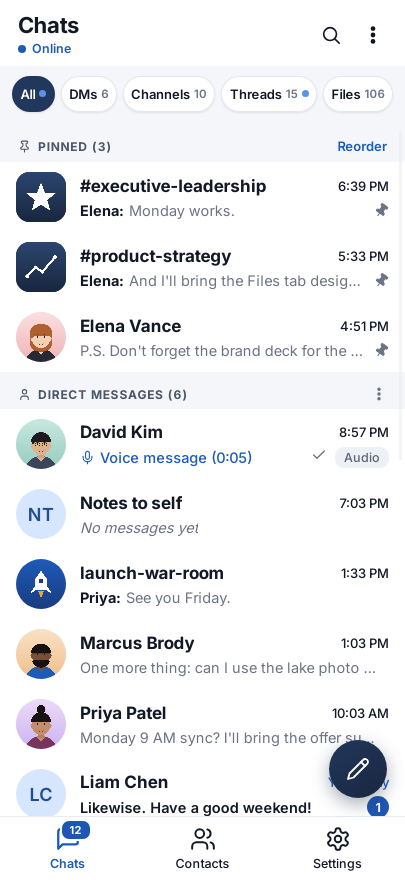
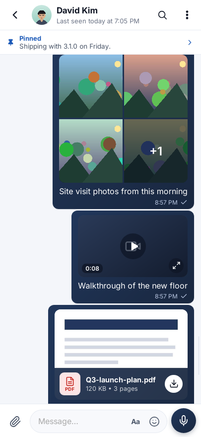
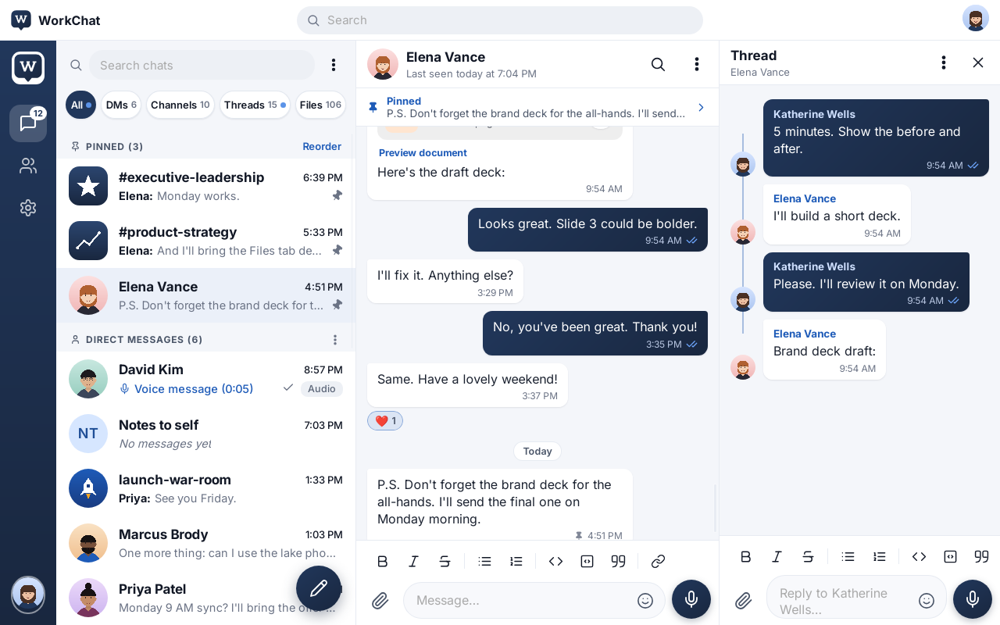
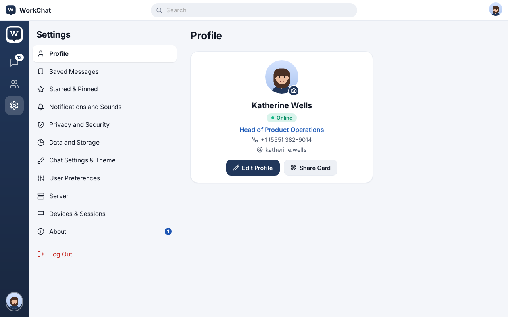
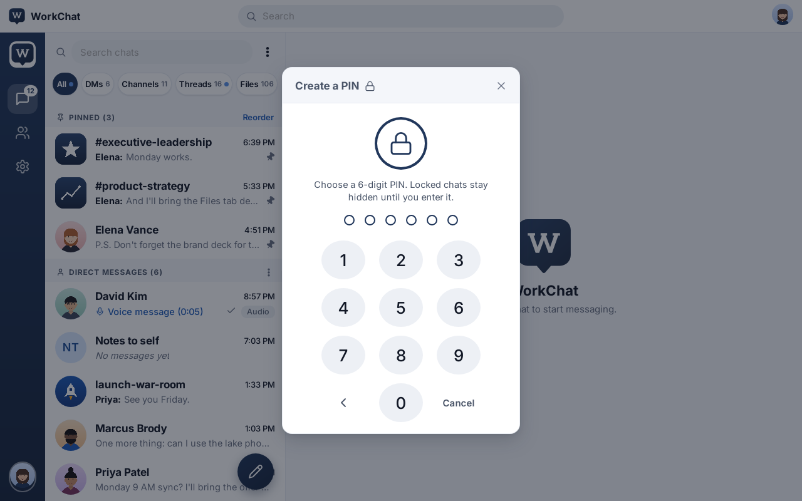

# WorkChat

A self-hosted team chat. One small Rust server (Docker, with a built-in admin panel) plus apps for Windows, Linux, Android and iOS.
Your data stays on your server. Direct messages, channels, threads, voice messages, files of any type, a rich-text composer,
per-chat PIN lock (Lock / Unlock), and push notifications through your own ntfy server (FCM and APNs optional). No calls, no video calls.

## Screenshots

| Chat list (phone) | Conversation (phone) |
|---|---|
|  |  |



| Settings (desktop) | Lock a chat with a PIN (desktop) |
|---|---|
|  |  |

## Repository layout

| Path | What |
|---|---|
| `workchat-server/` | The server: Rust (axum), SQLite, admin panel (TypeScript), Docker image, API docs, tests. See its [README](workchat-server/README.md) |
| `Clients/` | The apps: Tauri 2 (Rust core, Svelte 5 UI) for desktop and mobile. See its [README](Clients/README.md) |
| `images/` | App icon and the design reference screenshots |
| `docs/screenshots/` | Screenshots used in this README |
| `.github/workflows/` | `server-ci.yml`, `apps-ci.yml`, and `release.yml` (one release for server and apps) |
| `PLAN.md` | The original planning document |
| `CHANGELOG.md` | Release notes for the whole repository |

## Downloads

Everything is on the [Releases page](https://github.com/uri-travoski/workchat-claude/releases/latest). `<ver>` is the version, for example `1.1.0`.

| Platform | Asset |
|---|---|
| Windows x64 | `WorkChat-<ver>-windows-x64-setup.exe` (installer), `WorkChat-<ver>-windows-x64-portable.exe` |
| Windows arm64 | `WorkChat-<ver>-windows-arm64-setup.exe`, `WorkChat-<ver>-windows-arm64-portable.exe` |
| Linux x86_64 | `WorkChat-<ver>-linux-amd64.deb`, `WorkChat-<ver>-linux-x86_64.rpm`, `WorkChat-<ver>-linux-x86_64.AppImage`, `WorkChat-<ver>-linux-x86_64.flatpak` |
| Android | `WorkChat-<ver>-android-arm64.apk`, `WorkChat-<ver>-android-x86_64.apk` |
| iOS | `WorkChat-<ver>-ios-unsigned.ipa` (sideload, see [Clients/docs/RELEASE.md](Clients/docs/RELEASE.md)), `WorkChat-<ver>-ios-simulator.zip` |
| Server | `docker-compose.yml`, `workchat-server.env.example` |
| Checksums | `SHA256SUMS` (`sha256sum -c SHA256SUMS`) |

## Server quick start

The image `ghcr.io/uri-travoski/workchat-server` is public; nothing is built on your machine.

```sh
mkdir workchat && cd workchat
curl -fLO https://github.com/uri-travoski/workchat-claude/releases/latest/download/docker-compose.yml
curl -fL -o .env https://github.com/uri-travoski/workchat-claude/releases/latest/download/workchat-server.env.example
nano .env                    # at least WORKCHAT_PUBLIC_URL, the address your users will type
docker compose up -d
```

Open `http://<host>:8080/admin`, create the owner account and pick the attachment storage. A reverse proxy, Cloudflare Tunnel
and ntfy are not included. Details: [workchat-server/docs/DEPLOY.md](workchat-server/docs/DEPLOY.md).

## Building from source

Server (Rust stable, Node 22):

```sh
cd workchat-server
(cd admin-web && npm ci && npm run build)   # admin panel
cargo build --release                        # target/release/workchat-server
cargo test --workspace
docker build -f docker/Dockerfile -t workchat-server .
```

Apps (Rust 1.93, Node 22; on Linux the webkit2gtk 4.1 and GTK3 dev packages):

```sh
cd Clients
npm ci
npm run tauri dev                      # app with hot reload
npm run check && npm test              # TypeScript check and tests
cargo test --workspace
npm run tauri build -- --bundles deb   # release build (also rpm, appimage; nsis on Windows)
```

Android and iOS builds, signing and flatpak packaging are described in [Clients/docs/RELEASE.md](Clients/docs/RELEASE.md) and
[Clients/README.md](Clients/README.md).

## Updates

- **Apps**: Settings has "Check for updates", and the app checks once a day in the background. It reads
  `https://api.github.com/repos/uri-travoski/workchat-claude/releases/latest`, compares versions and offers the asset for the
  current platform by its exact name (the names above are a contract). Android downloads and installs the APK; Windows opens the
  installer; Linux shows the package or AppImage; iOS opens the release page.
- **Server**: the admin panel's Updates card reads the same release list (server side, cached, no data sent) and shows the commands.
  To update, download the new `docker-compose.yml` (it pins that release's image) and run `docker compose pull && docker compose up -d`,
  or set `WORKCHAT_IMAGE=ghcr.io/uri-travoski/workchat-server:latest` once.

## Releasing

Bump the version in `Clients/src-tauri/tauri.conf.json`, `Clients/Cargo.toml`, `Clients/package.json`, `workchat-server/Cargo.toml`, the image pinned in
`workchat-server/deploy/docker-compose.yml` and the Android `versionCode`, add a `## [x.y.z]` section to `CHANGELOG.md`, then
`git tag vX.Y.Z && git push origin main vX.Y.Z`. The Release workflow refuses a tag that does not match all of them. See
[Clients/docs/RELEASE.md](Clients/docs/RELEASE.md) for secrets and signing.

## License

MIT, see [LICENSE](LICENSE).
